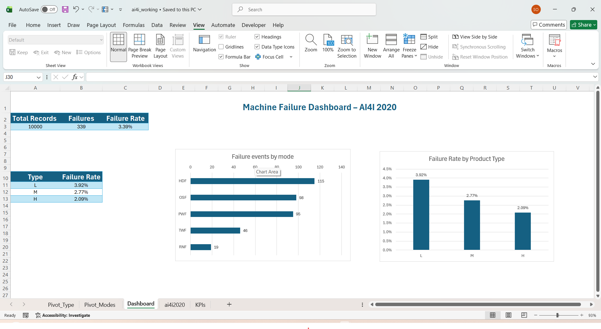

# Week 1 – Excel: First Look at the Data

## Goal
Understand the AI4I 2020 machine dataset and find where and why failures concentrate.

## Data
- Source: AI4I 2020 Predictive Maintenance Dataset (UCI), 10,000 records, 14 columns
- The raw file stays untouched in `data/raw/`. All work was done on a copy (`excel/ai4i_working.xlsx`)

## Steps
1. Converted the data into an Excel Table named `machine_data`
2. Built a KPI sheet with formulas:
   - Total records: `=COUNTA(machine_data[UDI])` gives 10,000
   - Failures: `=SUM(machine_data[Machine failure])` gives 339
   - Failure rate: failures divided by records gives 3.39%
3. Built a pivot table of failure rate by product type (L/M/H)
4. Built a pivot table of the five failure modes and charted it
5. Checked data quality with `COUNTIFS`: failures with no recorded failure mode
6. Combined the KPIs and both charts on one dashboard sheet

## Dashboard

## Insights
- Failures are rare (3.39%), so the data is highly imbalanced
- L-type products fail most: 3.92%, against 2.77% (M) and 2.09% (H)
- L is 60% of records but 69% of all failures (235 of 339)
- The top 3 failure modes (HDF 115, OSF 98, PWF 95) make up about 83% of all failure events
- Random failures (RNF) are the smallest group with 19

## Data quality
- 9 failed machines have no failure mode recorded (about 2.7% of failures). I kept them and treat their cause as unknown
- The failure modes add up to 373 events, which is more than the 330 failed machines with a recorded mode, so some machines failed in more than one way

## What I learned
- Formulas outside an Excel Table need the table name (`machine_data[Column]`)
- Never sum an ID column, use Count instead
- Keep single-answer KPIs on their own sheet, not inside the data table
- Always check that category totals fit the headline number

## Next
Week 2: the same data in MySQL, with the same questions answered in SQL (see `week2-mysql.md`).
